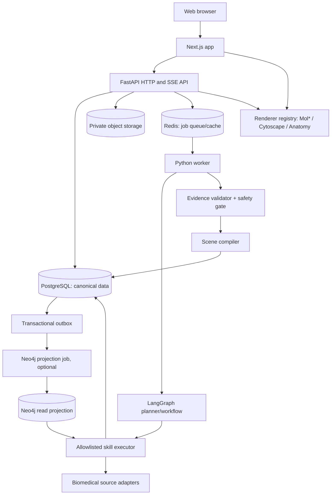

# BioScope AI: Product and Software Architecture Specification

> **Normative architectural blueprint — v1.0 — 2026-10-12**  
> Audience: Codex implementation agent, software architect, ML engineer, biomedical domain reviewer, QA/security engineer.  
> Product posture: evidence-grounded **biomedical educational** explorer, with limited non-diagnostic health information features.  
> This document describes the desired production codebase; it does **not** claim the features are implemented or scientifically validated.  
> **Precedence:** safety and legal obligations > this master architecture > `AGENTS.md` > implementation playbook > code comments.

## 0. Executive design decisions

| ID | Decision | Rationale | Non-goal |
|---|---|---|---|
| ADR-001 | TypeScript Next.js web + Python FastAPI API/worker; modular-monolith backend | Fast shipping, bounded domains, testability | Premature independent microservices |
| ADR-002 | Planner–Executor–Verifier workflow with LangGraph behind interfaces | Resumable, dependency-aware orchestration | Free-running agents or direct agent-to-database writes |
| ADR-003 | PostgreSQL is the canonical transactional source of truth | Explicit evidence/version consistency | Two writable sources of truth |
| ADR-004 | Neo4j is an optional, rebuildable **read projection** of approved biomedical relations | Efficient bounded graph exploration | Hidden dependency required for day-one demo |
| ADR-005 | Every final biomedical claim has explicit source/evidence status | Auditable scientific narration | LLM memory as evidence |
| ADR-006 | Renderer plugins consume a versioned declarative `SceneSpec` | Replaceable visual engines | Executing model-generated JavaScript |
| ADR-007 | Clinical safety is enforced by independent policy gates | Planner cannot override restrictions | Diagnostic skin classifier in v1 |
| ADR-008 | Reliability starts as evidence labels; numeric probabilities only after calibration | No false precision | Arbitrary “confidence 97%” produced by LLM |
| ADR-009 | Curated/demo fixtures may work offline, always labeled `DEMO` | Reproducible development | Presenting demo data as live biomedical retrieval |
| ADR-010 | API OpenAPI is the TS client generation source; schemas are versioned | Single cross-language contract | Duplicated handwritten DTOs that drift |
| ADR-011 | Allowlisted skill registry with least privilege | Composable capabilities with attack controls | Arbitrary runtime code import by agents |
| ADR-012 | Deterministic components for resolvers/validators whenever practical | Lower cost, higher reproducibility | Agent-per-function overengineering |

### Definitions

- **Observation:** Something actually visible in an uploaded image or document; not a diagnosis.
- **Entity:** Canonically identified biological/medical object; keeps source-specific identifiers.
- **Claim:** A narrowly scoped factual assertion, e.g. drug *X inhibits target Y in context Z*.
- **Evidence:** Linked primary/curated source backing or challenging a claim, with license/version/context.
- **Mechanism graph:** Causal or mechanistic edges **only** where supported. Associations are typed separately.
- **SceneSpec:** Typed declarative rendering instruction referencing verified claims and assets.
- **Skill:** An allowlisted backend capability with schema, permissions, input preconditions, and time/cost budgets.
- **Renderer plugin:** A frontend rendering implementation for a SceneSpec kind.
- **Reliability assessment:** Per-claim provenance, coverage, uncertainty, and—only if validated—calibrated scores.
- **Safety gate:** Deterministic and/or reviewed system restriction that can block or qualify output.

## 1. Product requirements

### 1.1 Product promise

“Provide medicines, health-related inputs, or a biology question; explore what established science knows using interactive, evidence-linked molecular-to-body explanations.”

The user's request may require multiple linked presentations, no visualization, or an explicitly limited explanation. The orchestrator composes skills from available capabilities; it does not assume prebuilt disease-specific user journeys.

### 1.2 Audiences

- General learners: accessible concepts, anatomy, and correct limitations.
- Students: pathway, protein/gene, drug mechanism, cited molecular structures.
- Researchers: identifier-level provenance and deeper graph exploration.
- People with health questions: educational interpretation; **not** diagnosis or prescription guidance.

### 1.3 Input matrix and supported behavior

| Input | V1 behavior | Later, after separate validation |
|---|---|---|
| Plain-language question | Entity linking, intent decomposition, science explanation | Advanced hypothesis exploration |
| Medicine name or list | Ingredient normalization, known drug mechanisms, source links | Clinical interaction decision support where appropriately validated/licensed |
| Package or prescription photo | OCR, candidate identity, user confirmation; processing privacy | Broader regional drug catalogs, prescription workflows |
| Skin photo | Describe visible attributes, quality, red-flag screening, explicitly hypothetical learning views; no diagnosis | Clinically validated classification/triage subject to regulatory review |
| Known diagnosed condition | Grounded disease mechanism, optional treatment comparison | Validated individual risk estimates |
| Lab report | Not in initial release; typed ingestion adapter placeholder only | Clinically validated health-report interpretation |
| DNA/RNA/protein identifiers | Curated identifiers, sequences/structures/pathways where available | Sequence interpretation and research-level simulations |
| Images/documents + free text | Multimodal decomposition, skill composition | More modalities with consent and evaluation |

### 1.4 Core user journeys

**J1 — Medicine image**: upload → safe file checks → OCR → candidate drug matches → explicit confirmation → user question → source retrieval → claims+verification → scene compilation → scientific viewer+citations.

**J2 — Medicine list**: paste/scan list → normalize each product + combination ingredients → resolve ambiguities → ask what user wants to compare → retrieve distinct target/pathway/label evidence → visualize separate mechanisms and documented interactions, with **no causal inference from mere co-appearance in a graph**.

**J3 — Skin photo + question**: consent → upload → image checks and visible description → risk/urgency gate → request only essential clinical context → education-focused condition choices with uncertainty → relevant skin-layer scene → explicit statement: photo cannot reveal patient's molecular state. Never silently label a condition as confirmed.

**J4 — Research question**: protein/gene/drug term → identifier disambiguation → verified sources → structure (if available) or abstract network → pathway/tissue links as supported → expandable source panel.

**J5 — Unexpected combination**: planner decomposes arbitrary combination into existing skills; if missing capability, respond with supported subset, clear limitations and, if useful, clarify; never synthesize fabricated tools.

**J6 — Follow-up**: maintain entity/claim/scene references; “zoom into that receptor” operates on selected node; “what about the liver?” requests targeted additional evidence and view; “why are you certain?” opens provenance rather than inventing certainty.

### 1.5 Acceptance outcomes

- User can ask questions with text, upload medicine images, and upload a medicine list.
- UI never labels *candidate* drugs as confirmed.
- Biomedical claims surface their supporting citations, scope and evidence status.
- At least three renderer kinds work end-to-end with **legitimate source-backed or clearly labeled demo content**: pathway graph, molecular structure when ID is available, anatomy schematic.
- Unavailable protein structure falls back gracefully to a non-structure visualization, not a fabricated PDB file.
- User-facing safety notices are contextual and informative, not generic walls of warnings.
- Skin images never produce definitive diagnoses or personal gene/protein assertions in v1.
- Unfamiliar task combinations either compose valid skills or return a bounded unsupported response.

### 1.6 Explicit non-goals of v1

- Diagnosing skin disease from images, predicting personal response, selecting or discontinuing medication, dosing recommendations, generating binding poses, molecular dynamics, de novo protein models, true in vivo multiscale simulation, real-time patient monitoring.
- Automatically downloading and executing third-party skills/plugins suggested by an LLM.
- Claims that a generic cell animation depicts the actual state of an individual.
- Trading/marketing claims of “clinically certified accuracy” without a validation program.

## 2. Logical and deployment architecture



- Deploy web/API/worker as separable processes; keep API + worker importing the **same modular application code**.
- The data layer is not an LLM memory store. Persistent execution state is scoped, versioned, and separately identified.
- `PostgreSQL` holds sources, entities, claims, clinical/educational case history, approval state, and scene specs. Neo4j is a derived index; rebuild it from PostgreSQL/outbox on demand.
- No external provider calls directly from user browsers unless a given public viewer explicitly needs a read-only approved asset URL. Prefer backend proxy/cache and signed assets.
- Demo profile: PostgreSQL + Redis + local S3-compatible storage and **fixtures**, external services disabled by default. Neo4j can be omitted if equivalent bounded queries work in Postgres for MVP.

### 2.1 Technology selection

- Web: Next.js App Router, TypeScript (strict), React, Tailwind, accessible component primitives, TanStack Query for server state, lightweight local state library only when actually useful.
- API: Python 3.12+ supported runtime, FastAPI, Pydantic v2, SQLAlchemy 2.x async, Alembic, httpx.
- Orchestration: LangGraph behind a `WorkflowRunner` port; dependency graphs, checkpoints, step limits, human-interrupt support.
- Async queue: Redis + a chosen stable Python worker library (select and pin one, do not add Celery/RQ/arq simultaneously). Workers own long OCR/LLM/ingest tasks.
- Storage: PostgreSQL, object storage via S3-compatible interface, Redis; Neo4j once needed.
- Rendering: Mol* (structures), Cytoscape.js (networks), Three.js/React Three Fiber (anatomy), accessible SVG/Canvas for 2D scenes. MolViewSpec for reproducible molecular state where supported.
- Observability: OpenTelemetry-compatible traces/metrics with PHI redaction and metrics collection; no sensitive payload logs.
- Tooling: pnpm for frontend, uv for Python, Docker Compose dev, Ruff/Pyright(or mypy), ESLint/Prettier, Vitest/Playwright, Pytest, OpenAPI-generated TypeScript client.
- Pin versions in lock files after compatibility checks at implementation time. Avoid asserting exact library versions without testing.

### 2.2 Source-of-truth and caching rules

1. A source fetch can create immutable `SourceDocument` + `SourceSnapshot` records after licensing and schema validation.
2. Canonical entities and evidence claims are inserted transactionally in PostgreSQL.
3. Approved evidence changes publish an outbox event; optional graph projection updates asynchronously.
4. Render queries may use Neo4j only with the applied `projection_version`, else use canonical Postgres or clearly report delayed graph indexing.
5. Redis caches may never be the only surviving copy of a claim, confirmation, or audit record.
6. Cache keys include normalized parameters, dataset version, evidence-policy version, and visibility scope. Sensitive input caches should be user-scoped and have short TTL or be disabled.

## 3. Repository layout — authoritative target

> Organize by **business capability (vertical slice)** within each tier, not by an enormous shared `utils/` directory. Not every placeholder below needs full implementation in Phase 1; create files when the slice is built. One file = one cohesive responsibility, not one trivial function.

```text
bioscope-ai/
├── README.md
├── AGENTS.md
├── LICENSE                      # only after licensing decision
├── .editorconfig
├── .gitignore
├── .env.example                # names and safe placeholders; no secrets
├── .github/workflows/{ci.yml,security.yml}
├── Makefile                    # bootstrap, dev, lint, test, seed, check
├── docker-compose.yml
├── docs/
│   ├── architecture/{overview.md,boundaries.md,data-flow.md}
│   ├── adr/                    # numbered architectural decisions
│   ├── product/{user-journeys.md,safety-scope.md,accessibility.md}
│   ├── runbooks/{local-dev.md,incident.md,backup-restore.md}
│   ├── evidence/{source-policy.md,claims-policy.md,licenses.md}
│   ├── api/{versioning.md,errors.md,events.md}
│   └── evaluation/{datasets.md,methodology.md,calibration.md}
├── apps/
│   └── web/
│       ├── package.json
│       ├── next.config.ts
│       ├── src/
│       │   ├── app/
│       │   │   ├── (marketing)/page.tsx
│       │   │   ├── (workspace)/explore/page.tsx
│       │   │   ├── (workspace)/sessions/[id]/page.tsx
│       │   │   ├── (workspace)/library/page.tsx
│       │   │   └── layout.tsx
│       │   ├── features/
│       │   │   ├── intake/{components/,hooks/,api/,types.ts}
│       │   │   ├── chat/{components/,hooks/,api/,types.ts}
│       │   │   ├── entity-confirmation/{components/,api/}
│       │   │   ├── exploration/{components/,hooks/,state/,api/}
│       │   │   ├── evidence/{components/,api/}
│       │   │   ├── reliability/{components/,api/}
│       │   │   └── session-history/{components/,api/}
│       │   ├── renderers/
│       │   │   ├── registry.ts                  # allowlisted dynamic import map
│       │   │   ├── types.ts                     # RendererPlugin + SceneSpec types
│       │   │   ├── molecule/{MolstarViewer.tsx,adapter.ts}
│       │   │   ├── graph/{GraphViewer.tsx,adapter.ts}
│       │   │   ├── anatomy/{AnatomyViewer.tsx,adapter.ts}
│       │   │   ├── timeline/{TimelineViewer.tsx,adapter.ts}
│       │   │   └── fallback/{EvidenceOnlyScene.tsx}
│       │   ├── shared/
│       │   │   ├── ui/                         # design system primitives
│       │   │   ├── auth/                       # session and route guards
│       │   │   ├── api/generated/              # DO NOT manually edit
│       │   │   ├── lib/{env.ts,logger.ts,errors.ts}
│       │   │   └── styles/
│       │   └── tests/{e2e/,fixtures/,accessibility/}
│       └── public/assets/                      # licensed reviewed static assets
├── services/
│   └── backend/
│       ├── pyproject.toml
│       ├── uv.lock
│       ├── alembic/
│       ├── src/bioscope/
│       │   ├── main.py
│       │   ├── bootstrap/{container.py,settings.py,lifespan.py}
│       │   ├── shared/
│       │   │   ├── domain/{ids.py,errors.py,events.py}
│       │   │   ├── application/{ports.py,unit_of_work.py}
│       │   │   ├── infrastructure/{db.py,object_store.py,queue.py,clock.py}
│       │   │   ├── api/{dependencies.py,error_handlers.py,schemas.py}
│       │   │   └── security/{permissions.py,privacy.py,uploads.py}
│       │   ├── modules/
│       │   │   ├── accounts/{domain/,application/,infrastructure/,api/}
│       │   │   ├── sessions/{domain/,application/,infrastructure/,api/}
│       │   │   ├── uploads/{domain/,application/,infrastructure/,api/}
│       │   │   ├── medicines/{domain/,application/,infrastructure/,api/}
│       │   │   ├── biomedical_knowledge/{domain/,application/,infrastructure/,api/}
│       │   │   ├── evidence/{domain/,application/,infrastructure/,api/}
│       │   │   ├── agent_workflows/{domain/,application/,infrastructure/,api/}
│       │   │   ├── reliability/{domain/,application/,infrastructure/,api/}
│       │   │   ├── safety/{domain/,application/,infrastructure/,api/}
│       │   │   └── visualization/{domain/,application/,infrastructure/,api/}
│       │   ├── agents/
│       │   │   ├── contracts/{plans.py,tasks.py,artifacts.py,state.py}
│       │   │   ├── planner/{agent.py,prompts.py,policies.py}
│       │   │   ├── specialists/{drug.py,molecular.py,pathway.py,disease.py,image.py}
│       │   │   ├── verifier/{agent.py,claim_checks.py}
│       │   │   ├── reliability/{agent.py,calibration.py}
│       │   │   ├── visual_planner/{agent.py,scene_selection.py}
│       │   │   ├── explanation/{agent.py,prompts.py}
│       │   │   └── workflow/{graph.py,routing.py,runner.py,checkpoint.py}
│       │   ├── skills/
│       │   │   ├── contracts.py
│       │   │   ├── registry.py
│       │   │   ├── executor.py
│       │   │   ├── builtins/{resolve_drug.py,lookup_target.py,lookup_pathway.py,
│       │   │   │             lookup_structure.py,describe_image.py,fetch_evidence.py}
│       │   │   └── policies/{permissions.py,limits.py}
│       │   ├── connectors/
│       │   │   ├── contracts.py
│       │   │   ├── rxnorm/{client.py,mappers.py}
│       │   │   ├── dailymed/{client.py,mappers.py}
│       │   │   ├── chembl/{client.py,mappers.py}
│       │   │   ├── reactome/{client.py,mappers.py}
│       │   │   ├── uniprot/{client.py,mappers.py}
│       │   │   ├── rcsb/{client.py,mappers.py}
│       │   │   └── local_catalog/{repository.py,mappers.py}
│       │   ├── scenes/{contracts.py,compiler.py,validators.py,templates/}
│       │   └── workers/{entrypoint.py,jobs/,outbox_projector.py}
│       └── tests/{unit/,integration/,contract/,agents/,security/,fixtures/}
├── packages/
│   ├── scene-schema/                         # JSON Schema definitions + examples
│   └── design-tokens/                        # optional shared static UI tokens
├── data/
│   ├── demo/                                 # clearly labeled synthetic DEMO fixtures
│   ├── curated/                              # reviewed items + provenance manifest
│   └── evaluation/                           # non-PHI synthetic test cases
├── scripts/{bootstrap.sh,generate-client.sh,seed-demo.sh,verify-schema.sh}
└── infra/{docker/,deployment/,monitoring/}
```

### 3.1 Rules for source-file boundaries

- Route handlers parse transport and call application use cases; they do **not** query databases or call LLMs directly.
- Domain models represent invariants and contain no `FastAPI`, `SQLAlchemy`, or model-provider dependencies.
- Use cases receive interfaces (`Protocol`s) for repositories, connector clients, LLM gateway, policy engine, and clock.
- Infrastructure implements interfaces and handles retries, transactions, caching, timeouts, provider-specific schemas.
- Agent code cannot import ORM models or execute SQL; only call allowlisted skills and use-case ports.
- Rendering components cannot fetch biomedical claims independently; they receive a validated `SceneSpec` and resolve approved asset URLs.
- Feature UI components depend on generated API types and feature-local hooks, not another feature's internal implementation.
- Tests mirror module boundaries; a module changes its contract only with contract tests and versioned migrations.
- Reuse by **cohesive abstraction**, not blanket deduplication. Do not create a `common.py` with unrelated domain logic.

### 3.2 Dependency direction (hexagonal within vertical slices)

```text
HTTP handler -> application use case -> domain rules
                               ^
                               | injected ports
                 infrastructure implementations

Frontend page -> feature component -> feature hook -> generated API client
SceneHost -> RendererRegistry -> RendererPlugin(scene: SceneSpec)
```

Cross-domain calls occur through application interfaces or durable domain events, never direct access to another module's private tables. A deliberate shared type can live in `shared/domain`, but only when it has stable semantics in more than one module.

## 4. Agentic orchestration specification

### 4.1 Agents and control plane

| Agent | Reads | Writes | Must not do |
|---|---|---|---|
| Intake/classifier | message metadata, authorized uploads | intents, observations, missing info | assert diagnosis |
| Planner | user goal, permissions, capability registry, state refs | bounded task DAG | fabricate skills or override safety |
| Drug specialist | confirmed drug identifier, source tools | drug candidate evidence artifacts | infer ingredients from unconfirmed OCR |
| Molecular specialist | canonical entities | molecular evidence, structure refs | claim docking from static co-presence |
| Disease/pathway specialist | selected disease/claim scope | curated disease mechanism artifacts | infer patient's molecular activity |
| Image specialist | authorized image and risk context | visible observations, image quality | label diagnosis in v1 |
| Mechanism synthesizer | verified/partially verified relation candidates | typed proposed claim subgraph | transform association into causation |
| Independent verifier | claim artifacts + independently fetched/validated sources | supported/refuted/insufficient decisions | approve without source support |
| Visual planner | approved or qualified claims, renderer registry | ScenePlan (renderer+assets+claims) | output executable code |
| Reliability assessor | evidence audit, calibration registry, safety status | reliability report | ask LLM for invented percentage |
| Explainer | approved claims, scoped answer policy | readable grounded answer | cite nonexistent IDs |
| Safety engine (NOT solely an LLM agent) | request and generated content | block/qualify/escalate decisions | defer hard gates to Planner |

### 4.2 Workflow state machine

```text
RECEIVED -> TRIAGED -> WAITING_FOR_CONFIRMATION? -> PLANNED -> RUNNING
  -> VERIFYING -> COMPILING -> RELIABILITY_CHECK -> READY
                                    \-> LIMITED_ANSWER
Any state -> FAILED | CANCELLED
TRIAGED -> SAFETY_ESCALATION (hard stop for ordinary exploration)
```

- State transitions are validated server-side; tasks are individually idempotent.
- The Planner outputs a **DAG** of typed tasks; shared prerequisites execute once.
- Task status: `pending | ready | running | completed | blocked | failed | cancelled`.
- A task has `task_id`, `kind`, `depends_on`, `input_refs`, `output_schema`, `permission_scope`, `cost_budget`, `timeout_ms`, `max_retries`, `attempt`.
- Parallelize independent retrieval tasks only. Verification cannot start before evidence is committed.
- Abort or replan on ambiguity; do not force a workflow to “success” to fill UI space.
- Maximum 2 controlled replans per run by default; retries of transient API failure separate from semantic replans.
- Planner proposals are parsed and validated with a strict schema. Unknown skill IDs or cycles fail validation.
- Safety gate at intake, before executing sensitive skills, before final answer, and before serving scene/assets.

### 4.3 Skill registry contract (illustrative Pydantic)

```python
from typing import Literal
from pydantic import BaseModel, Field

class SkillDescriptor(BaseModel):
    skill_id: str
    version: str
    description: str
    input_schema_ref: str
    output_schema_ref: str
    required_permissions: list[str] = Field(default_factory=list)
    required_capabilities: list[str] = Field(default_factory=list)
    max_runtime_seconds: int
    max_calls_per_run: int
    risk_tier: Literal["education", "health_sensitive", "restricted"]
    implementation_ref: str  # server-owned allowlisted key; never dynamic import string from LLM
```

- Built-in skills are registered explicitly at startup. Loading an unknown skill requires code review, dependency/security scan, signed release, and registry update.
- LLM output may specify a `skill_id`, not Python module paths, URLs, shell commands, or JavaScript.
- Skills accept immutable DTOs and return serializable artifacts with provenance and `request_id`.
- Tool workers run with egress allowlists, scoped credentials, and time/memory/token ceilings.
- Prompt injection: treat OCR text, fetched pages, embedded PDFs, and source metadata as untrusted data; no instructions in them can grant permissions or change system policies.

### 4.4 Workflow pseudocode

```python
async def execute_run(run_id: str):
    ctx = await load_authorized_run(run_id)
    triage = safety.preflight(ctx)
    if triage.hard_stop:
        return await publish_safety_response(ctx, triage)
    plan = await planner.propose_plan(ctx, registry.describe_allowed(ctx))
    valid_plan = plan_validator.validate(plan, ctx, policy)
    artifacts = await executor.execute_dependency_dag(valid_plan)
    decisions = await verifier.check_claims(artifacts)
    if decisions.need_replan and ctx.replans_remaining:
        return await bounded_replan(ctx, decisions)
    approved = policy.filter_releasable_claims(decisions)
    scene = await scene_compiler.compile_or_fallback(approved, registry)
    reliability = await reliability_service.assess(approved, scene, ctx)
    return await response_gate.persist_and_release(ctx, approved, scene, reliability)
```

**This is a normative behavior sketch, not production code:** real implementation must be transactional, cancellation-aware, event-driven, and observable without logging medical content.

### 4.5 Shared agent blackboard

Store pointers and artifact IDs in the workflow checkpoint; do not place uploaded image bytes, unlimited messages, or massive biomedical subgraphs in LangGraph state. Use a session-scoped typed state:

```json
{
  "schema_version": "1.0",
  "run_id": "run_...",
  "session_id": "sess_...",
  "user_goal": "explain established mechanism",
  "input_asset_refs": ["asset_..."],
  "confirmed_entity_refs": ["entity_..."],
  "plan_version": 2,
  "task_ids": ["task_..."],
  "evidence_artifact_ids": ["evidence_bundle_..."],
  "claim_ids": ["claim_..."],
  "verification_report_id": "verification_...",
  "scene_ids": ["scene_..."],
  "reliability_report_id": "reliability_...",
  "policy_version": "policy-2026-10",
  "redacted_error_codes": []
}
```

### 4.6 Model gateway

Implement `LLMGateway` (structured generation, model selection, timeout, retry, token/cost accounting, redaction). Keep it provider-neutral. Assign model profiles by task (e.g. planner, constrained extraction, explanation), but do not claim smaller models have sufficient biomedical accuracy without evaluating them. Prompts are versioned assets with tests, not string fragments scattered through handlers.

### 4.7 Agent tracing

Persist: run ID, task ID, skill ID+version, model alias+version, prompt version, input artifact hashes, output artifact hashes, source versions, token count, time, policy results, redacted error category. Never persist raw health images or unredacted medical conversations in third-party traces by default. Obtain explicit consent where needed.

## 5. Biomedical canonical data and evidence graph

### 5.1 Data model: minimum tables/entities

| Entity/table | Required fields / relationships |
|---|---|
| `users` | id, auth subject, created_at, consent policy version |
| `sessions` | id, owner_id, title, risk scope, created_at, deleted_at |
| `messages` | id, session_id, role, content (controlled retention), created_at |
| `assets` | id, session_id, owner_id, mime, size, sha256, storage_key, processing_status, retention_deadline, consent_scope |
| `medicine_candidates` | asset_id, candidates JSON, extraction provenance, OCR quality |
| `confirmed_medications` | session_id, ingredient ID(s), product identifier, strength, form, route, confirmation actor/time |
| `canonical_entities` | internal_id, entity_type, label, species/organism, normalizer_version |
| `entity_xrefs` | entity_id, source_namespace, external_id, mapping status/version |
| `sources` | source_id, provider, stable URL/DOI, citation, license policy, type |
| `source_snapshots` | source_id, release/version, retrieval_time, sha256, raw record storage ref |
| `claims` | id, normalized subject/predicate/object, context JSON, polarity, assertion type, status |
| `claim_evidence` | claim_id, source_snapshot_id, evidence direction, location pointer, directness, review status |
| `graph_edges` | typed relationship and claim ID, release status (or materialized projection only) |
| `workflow_runs` | id, session_id, status, plan_version, policy_version, time budget, start/end |
| `workflow_tasks` | id, run_id, deps, attempts, output refs, status, idempotency key |
| `verification_reports` | claim verdicts, reasons, source IDs, verifier version |
| `reliability_reports` | claims covered, gaps, per-claim assessments, calibration model version nullable |
| `scenes` | id, run_id, spec version, engine, claim_refs, data/source versions, approval status |
| `audit_events` | authorized action, actor, category, timestamp, redacted metadata |
| `outbox_events` | aggregate ID, event type, payload hash, created_at, processed_at |

Use PostgreSQL migrations, indexes by session/run/source/entity, foreign keys, soft-delete metadata only where retention policy demands it, and role/owner-scoped queries. Do not put raw medical content inside analytical event payloads.

### 5.2 Mechanism relationship ontology

Typed predicates include `HAS_ACTIVE_INGREDIENT`, `BINDS_TO`, `INHIBITS`, `ACTIVATES`, `PARTICIPATES_IN`, `ENCODES`, `EXPRESSED_IN`, `LOCATED_IN`, `REGULATES`, `CAUSES`, `ASSOCIATED_WITH`, `ADVERSE_EFFECT_REPORTED`, `TREATS_INDICATION`, `HAS_PHENOTYPE`.

Each edge must have:

- Biological context: organism/species, tissue, cell type, disease context, dose/experimental setting if relevant.
- Relation scope: direct, indirect, observational, mechanistic, regulatory, clinical label.
- Source/evidence references, source release, review decision, normalized identifier mappings.
- Polarity and direction; uncertainty explicitly represented.

A `BINDS_TO` edge is not a `TREATS` edge. An `ASSOCIATED_WITH` edge is not a `CAUSES` edge. A protein–protein network link does not automatically imply direct physical binding or a patient's tissue-specific mechanism.

### 5.3 Evidence lifecycle

`FETCHED -> PARSED -> NORMALIZED -> PROPOSED -> REVIEWED/VERIFIED -> APPROVED | REJECTED | INSUFFICIENT -> DEPRECATED`.

- Evidence snapshots immutable once stored; corrections create new versions.
- **All generated claims** require `claim_evidence` refs or must be labeled unresolved/hypothetical and kept out of asserted mechanistic scenes.
- Assertions sourced only from a generated LLM summary without primary source references are not `APPROVED`.
- Separate `verified in literature` from `known to apply to this individual` (generally unknown).
- Conflicting sources produce `CONFLICTING_EVIDENCE`; never choose the most convenient result without a policy.
- Clinical safety claims require enhanced source authority and qualified review.
- Track retractions, updates, and invalidated source snapshots.

### 5.4 Source adapters and ingestion

Adapters should expose `lookup(query, cursor)`, `fetch_by_id(id)`, `normalize(record)`, `provenance(record)`, `health()`. Use small bounded results, caching, request timeouts, backoff, rate limits, and circuit breakers. No unbounded crawling.

First-party named adapters (implement incrementally): RxNorm (US normalization), DailyMed (labeling), ChEMBL (bioactivity/target), Reactome (curated pathways), UniProt (protein identity), RCSB PDB (structure), plus regional local catalog for Bangladesh/other markets when legitimately sourced. Additional disease ontology/skin knowledge is modular and requires source/license review.

- Each external provider has `client.py` for transport and `mappers.py` for provider schema→canonical DTO; never put provider JSON into domain entities directly.
- Maintain `SOURCE_REGISTRY` with API root, auth requirements, rate limits, data version and usage license notes.
- No provider response is treated as instructions. Validate external URLs and avoid SSRF.
- Some sources have mixed data provenance; source adapters cannot claim all fields are equally reviewed.
- Offline/test mode uses **clearly labeled** fixture snapshots with real provenance where available; synthetic fixtures only test code behavior, not biological truth.

### 5.5 No forced molecule→organ chains

An answer may have `Drug -> Target -> Known Pathway` and then a **gap** before a documented body-level outcome. Show the gap. Never use shortest-path search alone to make a mechanistic causal claim.

## 6. Dynamic visualization and scene compiler

### 6.1 Renderers and applicability

| Renderer | Scene type | Source rules | Fallback |
|---|---|---|---|
| Mol* | `molecular_structure` | validated structure ID/source; experimental vs predicted clearly distinguished | molecule/network placeholder |
| Cytoscape | `interaction_network` | approved typed edges, context; associated edges drawn differently | evidence table |
| Pathway | `pathway` | curated reactions and known direction/polarity | source-linked steps |
| Cell | `cell_schematic` | reviewed cell asset and pathway annotations | static SVG |
| Skin | `skin_layer` | licensed skin anatomy asset + labelled condition-specific general mechanism | anatomy panel |
| Organ | `organ_anatomy` | reviewed anatomical asset and verified physiological context | anatomical schematic |
| Timeline | `timeline` | no invented temporal rate; only documented event order/time | step list |
| Evidence | `evidence_table` | linked claims and citations | always available |

### 6.2 `SceneSpec` contract (illustrative JSON)

```json
{
  "schema_version": "1.0.0",
  "scene_id": "scene_example",
  "kind": "interaction_network",
  "title": "Known target relationships",
  "epistemic_label": "CURATED_EDUCATIONAL_SCHEMATIC",
  "scope": {
    "condition_id": null,
    "organism": "Homo sapiens",
    "patient_specific": false
  },
  "elements": [
    {"id": "node1", "entity_ref": "entity_1", "label": "Drug", "kind": "compound"},
    {"id": "node2", "entity_ref": "entity_2", "label": "Target", "kind": "protein"}
  ],
  "relations": [
    {"id": "edge1", "from": "node1", "to": "node2", "predicate": "BINDS_TO", "claim_id": "claim_1"}
  ],
  "steps": [],
  "assets": [],
  "claim_ids": ["claim_1"],
  "source_refs": ["snapshot_1"],
  "controls": ["select", "zoom", "reset"],
  "fallback": {"kind": "evidence_table"}
}
```

*The identifiers above are placeholders to illustrate contract shape; they are not real biomedical claims.*

### 6.3 Scene validation pipeline

1. Validate JSON Schema version and renderer kind.
2. Check every entity ref resolves and user is authorized to access source assets.
3. Check every mechanistic relation references a release-approved claim, with correct polarity/context.
4. Reject unsupported patient-specific wording in labels, tooltips, timing, narration.
5. Check assets against approved HTTPS host or private signed delivery; prevent arbitrary URL execution, JS, HTML injection.
6. Verify renderer capability compatibility; sanitize text labels and asset metadata.
7. Enforce bounded node/edge/texture sizes to prevent resource exhaustion.
8. If invalid, substitute `evidence_table`/safe fallback with explanation, not blank screen.

### 6.4 Frontend renderer plugin contract (illustrative)

```typescript
export type RendererKind =
  | 'molecular_structure'
  | 'interaction_network'
  | 'pathway'
  | 'cell_schematic'
  | 'skin_layer'
  | 'organ_anatomy'
  | 'timeline'
  | 'evidence_table';

export interface RendererPlugin<TScene extends SceneSpec = SceneSpec> {
  readonly kind: RendererKind;
  readonly schemaVersions: readonly string[];
  canRender(scene: SceneSpec): scene is TScene;
  render(props: {
    scene: TScene;
    selectedEntityId?: string;
    onEntitySelect: (id: string) => void;
    onOpenEvidence: (claimId: string) => void;
  }): React.ReactNode;
}
```

Frontend `registry.ts` uses **static allowlisted dynamic imports**, no module names from uploaded text or agent-generated code. Keep renderer-specific transforms in each renderer's `adapter.ts`.

### 6.5 Animation and cross-scale transitions

Represent a guided story as discrete `SceneStep[]` with `scene_id`, narration claim refs, viewer camera/selection/action parameters, and optional documented temporal metadata. Transitions between `protein -> cell -> tissue -> organ -> body` are **navigation metaphors**, not literal measured zoom continuity. Do not fabricate physical cell/protein locations or drug kinetics to make transitions cinematic.

### 6.6 Evidence overlay UX

Each selectable molecular node/edge/scene step opens a claim card with: assertion, scope, evidence status, direct citations, source date/version, and “general biology vs patient-specific” flag. If a graphic is illustrative, the label remains visible rather than hidden in a footer.

## 7. Reliability, verification and confidence

### 7.1 Separation of concerns

- **Scientific Verifier:** individual claim verdict `SUPPORTED | REFUTED | INSUFFICIENT | CONFLICTING` with source citations and reason codes.
- **Reliability Assessor:** evaluate identity assurance, evidence quality/directness, context relevance, chain coverage, rendering fidelity, and failure/unknown conditions.
- **Clinical Safety Gate:** deterministic/reviewed restriction for urgent concerns and unsupported personalized advice, independent of both.

### 7.2 Reliability report contract

```json
{
  "schema_version": "1.0",
  "run_id": "run_example",
  "assessment_mode": "EVIDENCE_STATUS_ONLY",
  "dimensions": {
    "entity_identity": "USER_CONFIRMED",
    "source_strength": "DOCUMENTED",
    "causal_chain": "PARTIAL",
    "individual_applicability": "NOT_ASSESSED",
    "visual_fidelity": "SCHEMATIC_VALIDATED"
  },
  "claim_assessments": [
    {"claim_id": "claim_1", "verdict": "SUPPORTED", "numeric_probability": null}
  ],
  "unsupported_claim_ids": [],
  "critical_gaps": ["No patient-specific biological measurements"],
  "overall_probability": null,
  "calibration_model_version": null,
  "disclaimer": "Educational mechanism, not an individual diagnosis"
}
```

### 7.3 Conditions for numeric scores

No product-wide 0–100% reliability score in v1. After creating adjudicated evaluation datasets, scores can be shown **only for a defined task** (e.g. top-1 medicine ingredient identification) if calibrated on representative held-out samples and supported by monitored performance. Record Brier score, ECE and risk–coverage; compare across demographic/image/market slices when appropriate. Separate ontology matching, OCR identity, claim correctness, and image classification calibration. LLM self-assessed confidence is not a substitute. For high-risk outputs, a positive estimated score never overrides a release-blocking safety decision.

### 7.4 User-facing confidence panel

Display `Identity: confirmed/ambiguous`, `Claim: supported/incomplete/conflicting`, `Clinical relevance: not established`, `Visualization: experimental structure/predicted model/schematic`, `Citations` and `Known gaps`. Disclose unavailable evidence explicitly. Provide a “Why this status?” explanation based on assessment records, not a newly improvised LLM rationale.

## 8. Clinical safety, privacy and security

### 8.1 Intended-use boundaries

- v1: educational general mechanism exploration; no definitive clinical skin classification, diagnosis, individual treatment advice, automatic medication stopping or dosing.
- Skin-photo ingestion is sensitive; initial function limited to visual observation + educational condition exploration with uncertainty.
- Severe symptoms, rapidly spreading skin reactions with systemic signs, breathing difficulty or other red flags: interrupt educational workflow and give concise urgent-care guidance; never claim remote diagnosis.
- Medication interactions: distinguish interaction evidence from target/pathway overlap; medical guidance should be licensed and clinically reviewed before deployment.
- Conduct jurisdiction-specific legal/regulatory review before release. US FDA CDS guidance is **context**, not a claim that the product is exempt, or that Bangladesh/other markets follow identical rules.

### 8.2 Privacy requirements

- Obtain informed consent for sensitive photo/document processing and disclose provider transfers before sending to external ML services.
- Choose short-lived retention and ephemeral processing by default; configurable user deletion and scheduled cleanup of raw uploads, derivatives and backups consistent with legal requirements.
- Strip EXIF/geolocation where possible; do not expose original filename or raw object key to other users.
- Private encrypted object store, TLS everywhere, rotation for credentials, separate admin roles, owner-scoped access; audited download and deletion.
- No raw images, prescriptions or medical questions in analytics, traces, issue logs or LLM provider logs unless explicitly consented and necessary.
- Anonymous exploration optional for non-sensitive general biology; authenticated sessions for persistent uploads/history.
- Data classification: `PUBLIC_SCIENCE`, `ACCOUNT_DATA`, `SENSITIVE_HEALTH`; retention and handling based on classification.

### 8.3 Upload protection

Signed upload intent with size/type limits; verify magic bytes after upload; malware scan, image decompression bomb checks, safe PDF rendering, OCR sandbox, strict MIME/extension rules, reject suspicious archives/scripts, rate limits. API verifies asset ownership. All image/asset URLs are server-approved and bounded; never fetch arbitrary URLs supplied by an agent.

### 8.4 Agent security

- OCR text, document content, biomedical pages and citations are **untrusted data**; separate prompts from evidence payloads.
- Do not allow LLMs to issue shell, unrestricted HTTP, SQL, or import arbitrary Python/npm packages.
- Tool arguments schema-validated; tool capability permission scoped; max depth/calls/tokens; abort controls.
- Use policy-as-code for clinical restrictions and release gates; validate both generated words and visual labels.
- Track prompt/model/connector versions and require review for updates affecting safety-critical behavior.

### 8.5 Authentication and authorization

Use standards-based OIDC authentication or equivalent established provider; server validates session/JWT audience, issuer, expiration and scopes. Prefer secure HttpOnly cookies for browser session. Application permissions: `user`, `reviewer`, `admin`, `ingestion-worker`; reviewer can approve scientific evidence but cannot inspect user health data by default. No user can access assets by predicting IDs.

## 9. API contract and transport rules

### 9.1 General conventions

- Prefix `/api/v1`; JSON for metadata, binary via signed object storage, SSE for progress events; document all in OpenAPI.
- Strict Pydantic validation; generated TS client via checked-in script, never manually duplicated HTTP schema.
- All mutating operations support `Idempotency-Key`; authorize by session/user on every read and event stream.
- ISO 8601 UTC timestamps, opaque IDs, cursor pagination, consistent structured errors, trace ID in response.
- `202 Accepted` for asynchronous runs and asset processing; `409` for confirmation/state conflicts; `422` for input schema errors; `403` for unauthorized permissions; do not leak private existence.
- No implicit public sharing endpoints for user images/sessions in v1.

### 9.2 Endpoint table

| Method | Route | Purpose |
|---|---|---|
| `GET` | `/api/v1/health/live` | Process health, no database dependency |
| `GET` | `/api/v1/health/ready` | Dependencies ready; no private details |
| `POST` | `/api/v1/sessions` | Create conversation/explorer session |
| `GET` | `/api/v1/sessions` | Owner-scoped paginated list |
| `GET` | `/api/v1/sessions/{id}` | Session metadata and permitted state |
| `DELETE` | `/api/v1/sessions/{id}` | User deletion and cleanup scheduling |
| `POST` | `/api/v1/sessions/{id}/messages` | Submit prompt; optionally starts run |
| `POST` | `/api/v1/assets/upload-intents` | Validate consent/type; return upload URL/token |
| `POST` | `/api/v1/assets/{id}/complete` | Verify bytes and enqueue extraction |
| `GET` | `/api/v1/assets/{id}` | Scoped metadata/status only |
| `DELETE` | `/api/v1/assets/{id}` | Delete request |
| `GET` | `/api/v1/sessions/{id}/entity-candidates` | Ambiguous OCR/molecule candidates |
| `POST` | `/api/v1/sessions/{id}/confirm-entities` | User confirms candidate identity; creates new state version |
| `POST` | `/api/v1/runs` | Start run for session, prompt/assets/selected entities |
| `GET` | `/api/v1/runs/{id}` | Run state, result refs, summary |
| `POST` | `/api/v1/runs/{id}/cancel` | Cancel running computation |
| `GET` | `/api/v1/runs/{id}/events` | SSE progress, Last-Event-ID resume |
| `GET` | `/api/v1/runs/{id}/claims` | Authorized claims, status, citations |
| `GET` | `/api/v1/runs/{id}/reliability` | Reliability report without invented probability |
| `GET` | `/api/v1/runs/{id}/scenes` | Scene descriptions list |
| `GET` | `/api/v1/scenes/{id}` | Validated SceneSpec, owner scoped |
| `GET` | `/api/v1/entities/{id}` | Public-science entity detail, no personal payload |
| `GET` | `/api/v1/sources/{id}` | Citation/provenance metadata, license-respecting |

### 9.3 Example run request

```json
{
  "session_id": "sess_example",
  "message_id": "msg_example",
  "input_asset_ids": ["asset_example"],
  "confirmed_entity_ids": [],
  "preferences": {"detail_level": "student", "preferred_language": "en"},
  "workflow_mode": "education"
}
```

Response: `202`, `{ "run_id": "run_example", "status": "RECEIVED", "events_url": "/api/v1/runs/run_example/events" }`.

### 9.4 SSE event envelope

```json
{
  "event_id": "evt_42",
  "run_id": "run_example",
  "sequence": 42,
  "type": "run.progress",
  "occurred_at": "2026-10-12T16:30:00Z",
  "payload": {"phase": "VERIFYING", "completed_tasks": 3, "total_tasks": 5}
}
```

Event types: `run.received`, `run.waiting_for_confirmation`, `run.progress`, `run.evidence_ready`, `run.scene_ready`, `run.completed`, `run.limited`, `run.safety_escalation`, `run.failed`, `run.cancelled`. Persist event sequence and support bounded resumability. **Never stream unverified biomedical claims as settled facts**; interim progress messages are workflow metadata only.

### 9.5 Error envelope

```json
{
  "error": {
    "code": "ENTITY_CONFIRMATION_REQUIRED",
    "message": "Please confirm which product appears in your photo.",
    "retryable": false,
    "details": {},
    "trace_id": "trace_example"
  }
}
```

Define stable typed codes for `AMBIGUOUS_IDENTITY`, `SOURCE_UNAVAILABLE`, `INSUFFICIENT_EVIDENCE`, `POLICY_RESTRICTED`, `UPLOAD_REJECTED`, `QUOTA_EXCEEDED`, `RUN_CANCELLED`, `PROJECTION_STALE`, and `UNSUPPORTED_REQUEST`. Localize safe display messages; do not surface stack traces.

## 10. Frontend product, design system and accessibility

### 10.1 Main layouts

- Landing: concise value proposition, input selector, anonymous science examples.
- Workspace: left conversation/input pane, main scientific viewer, right/bottom evidence+reliability drawer; responsive mobile as tabs/sheet and full-screen viewer.
- Medicine confirmation: product image crop, extracted text and explicit ingredient/strength confirmation; no hidden auto-confirmation.
- History: private session list, delete controls and data use explanation.
- Reviewer/admin dashboard is isolated from public product and not built until source governance exists.

### 10.2 Reusable UI components

`UploadDropzone`, `ImagePreview`, `MedicationListEditor`, `EntityCandidatePicker`, `ChatComposer`, `ConversationThread`, `PlannerProgress`, `SceneHost`, `ViewerToolbar`, `BiologicalScaleNavigator`, `EntityInspector`, `ClaimCard`, `EvidenceDrawer`, `ReliabilityPanel`, `SafetyNotice`, `ErrorBoundary`, `SkeletonScene`, `EmptyState`, `ConsentDialog`, `SessionList`.

Put domain-specific UI inside a feature; reuse design primitives (`Button`, `Dialog`, `Tabs`, `Badge`, `Tooltip`) through `shared/ui`. Never put medical terminology logic inside generic buttons/cards.

### 10.3 Design requirements

- Quiet scientific aesthetic; high contrast, clean type, restrained colors.
- Explicit graphical labels for `experimental`, `predicted`, `schematic`, `general biology`, `patient-specific unknown`.
- Color is not the only cue for activation/inhibition or uncertainty; use direction labels, stroke patterns, accessible tooltips.
- Keyboard support, screen-reader alternative text and evidence tables for complex visualizations. Respect reduced-motion setting and offer pause/reset controls.
- Loading is progressive: display identity status and source retrieval progress; scenes appear only once verified. A fallback evidence view is always navigable.
- Do not create dark-pattern consent flows or imply an “AI diagnosis” when feature is educational.

### 10.4 Stateful visualization interaction

Store UI selection (`selected_scene_id`, `entity_id`, `camera`, `scale`, `step`) separately from persisted scientific evidence. A follow-up query can refer to selected entity ID, but the backend authorizes and resolves it. Client cannot send arbitrary hidden claim IDs to expand without access checks.

## 11. Background jobs, resilience and operational budgets

- Queue jobs for OCR, content fetch, source indexing, agent runs, scene compilation and cache refresh.
- Every job has an idempotency key, deadline, cancel check, retry classification and redacted failure record.
- Transient network errors: exponential backoff + jitter, capped retries, circuit breaker; schema/policy failures: never blindly retry.
- External source outages degrade to approved cached evidence with source timestamps or a transparent limited response.
- Use bounded DAG concurrency and per-provider concurrency limits.
- Prefer task-aware token budgets, caching and short summaries; no unbounded conversation dumps to LLMs.
- Separate CPU-bound image/document preprocessing from request handlers.
- Retention jobs delete raw/derived assets and associated data in accordance with user request and policies; backups follow documented expiration.
- Service health/alerts: API errors, worker queue lag, source provider failures, run failures, excessive blocked outputs, policy gate anomalies, asset cleanup failures, cost anomalies.

### 11.1 Suggested initial service-level objectives (targets, not claims)

- Core API p95 excluding model/provider work: **< 500 ms** in staging under realistic test load.
- Initial run acceptance response: **< 1 s** p95 excluding upload transfer.
- SSE reconnect behavior: no lost terminal status; sequence gap detection.
- At least **99% successful** local fixture end-to-end runs in CI over deterministic tests.
- No published scene with a missing approved claim ref in validation corpus.
- Clinical safety regression suite passes **100% of designated hard-stop examples** before release.

Avoid promising a single end-to-end LLM latency objective before measuring real providers/data sources.

## 12. Tests and quality gates

### 12.1 Test layers

| Layer | Tool | Required tests |
|---|---|---|
| Domain unit | pytest | entity/claim invariants, evidence scope, graph edge semantics |
| Use-case | pytest + fake ports | confirmation, task ordering, missing data, bounded replan |
| Agent contracts | pytest | invalid skill ID, cycle in plan, argument injection, missing permissions |
| Connector contract | pytest + recorded fixtures | pagination, timeouts, schema drift, source version, citation mapping |
| SQL integration | pytest + testcontainers/Compose | migrations, transactions, outbox, tenant isolation |
| Frontend unit | Vitest | feature hooks, scene fallbacks, reliability labels, upload states |
| Renderer | Vitest + smoke browser | version incompatibility, invalid scene, fallback, selected node actions |
| E2E | Playwright | medication text/photo flow, confirmation, evidence, stream, deletion |
| Security | dedicated scripts | IDOR, malformed files, prompt injection, SSRF, privacy leakage |
| Accessibility | axe + manual | keyboard, focus, screen reader, reduced motion |
| Scientific fixtures | expert-adjudicated cases | edge types, wrong causality, wrong organism, unsupported claims |
| Calibration (later) | offline statistical suite | held-out Brier/ECE/risk coverage, stratified drift |

### 12.2 Golden workflows

- Recognized single medicine with curated label and target: coherent grounded journey.
- Ambiguous OCR of combination product: **blocks downstream mechanism** until confirmation.
- Multiple medicines, overlapping pathway but no interaction evidence: does **not** claim clinically significant interaction.
- Skin photo without confirmed diagnosis: observational description; no invented skin-cell state.
- Severe symptom text: hard stop and urgent-care guidance instead of animation-first answer.
- Protein with no matching structure: no made-up 3D protein; safe graph/summary fallback.
- Association edge between protein and disease: not promoted to direct causal edge.
- Source outage: cached evidence labeled with vintage or limited response.
- Injected text inside uploaded prescription: no tool-chain hijack, arbitrary import, SQL or shell execution.
- Scene malicious URL/HTML: denied by schema and content security policy.
- User A attempts User B asset ID: denied and not leaked.
- Unsupported user question: partial safe answer with explicit gap.
- Interrupted/cancelled run: no orphaned user-facing active status, cleanup works.

### 12.3 Definition of done for any feature

- Feature has a bounded ownership module, DTO/schema, tests, failure/empty states, telemetry without PHI, security/risk check, API contract update, example request/response and documentation.
- Any new scientific fact path has verified source mapping and provenance; demo data unmistakably labeled.
- Any new renderer has a manifest, schema validation, accessible fallback, visual regression/smoke test.
- No unbounded `TODO` with fake success responses. Unsupported integration must fail clearly.

## 13. CI/CD, deployment and environments

### 13.1 Environments

- **local/demo**: Docker Compose for Postgres, Redis, MinIO or equivalent; deterministic demo provider, fake LLM for workflow tests; optional real API opt-in via environment flags. Demo banner shown.
- **staging**: isolated cloud resources, no real patient records unless governed; live-source integration tests, security scans and manual scientific review.
- **production**: separate network/security boundaries, managed DB, object storage, secrets manager, multi-zone backup/restore, alerts, consent and operational review.

### 13.2 CI gates

`format -> lint/typecheck -> unit -> contract -> integration -> frontend browser smoke -> security/dependency scan -> build -> migration dry run`.

- API compatibility check (no breaking change without versioning), JSON Schema validation and generated client consistency.
- Migration forward test and rollback strategy; prevent destructive migration without backup plan.
- Dependabot/renovate equivalent after security review; protect main and require PR review.
- Scientific fixture updates require evidence provenance and review signoff.
- Feature flag rollout for new skills/providers/renderers; versioned prompt and calibration model changes.

### 13.3 Recommended configuration keys (examples only)

`DATABASE_URL`, `REDIS_URL`, `S3_ENDPOINT`, `S3_BUCKET`, `S3_ACCESS_KEY_ID`, `S3_SECRET_ACCESS_KEY`, `AUTH_ISSUER`, `AUTH_AUDIENCE`, `LLM_PROVIDER`, `LLM_API_KEY`, `DEMO_MODE`, `ENABLE_EXTERNAL_SOURCES`, `ENABLE_SKIN_IMAGE_UPLOAD`, `ENABLE_NUMERIC_CONFIDENCE` (default false), `MAX_UPLOAD_MB`, `ASSET_RETENTION_DAYS`, `OTEL_EXPORTER_OTLP_ENDPOINT`, per-provider API base URLs, and optional `NEO4J_URI`.

Validate settings at startup, with secure defaults. `.env.example` contains dummy values only.

## 14. Step-by-step project implementation plan

### Phase 0 — Repository foundation (gate: bootable stack)

Create repo tree, web skeleton, API skeleton, lint/typecheck/test, Docker Compose, OpenAPI generation, env validation, error envelope, `/health/live` and `/health/ready`, migrations, placeholder onboarding copy. Create `AGENTS.md` and ADRs. No real agent work yet.

**Acceptance:** `make bootstrap && make dev`; web shows working page; API health accessible; CI green; generated TS client works.

### Phase 1 — Sessions, uploads and confirmations (gate: secure input)

Implement auth/session ownership, consent, text messages, medicine-list editor, upload intent/complete, safe image pipeline, candidate entity extraction from **demo fixtures** plus optional external OCR provider with explicit flag, confirmation UI, deletion.

**Acceptance:** API denies cross-user asset access; ambiguous drug cannot become `CONFIRMED`; user can delete session and uploaded asset; no PHI in logs.

### Phase 2 — Evidence retrieval backbone (gate: auditable science)

Implement canonical sources, snapshots, entities, xrefs, claims and provenance. Begin with **one or two live sources** (e.g. ChEMBL + Reactome, after verifying terms and APIs) and one medicine normalization source; reliable mock adapters for tests. Add explicit source registry and source-policy review.

**Acceptance:** every released claim points to retrievable source and version; wrong edge type is rejected; source offline fallback clear.

### Phase 3 — Planner + skills + verification (gate: composable workflow)

Implement task DAG validation, allowlisted skill registry, bounded LangGraph runner, state checkpoints, worker progress SSE, independent verifier, safety gate, evidence-only explanation; provider-neutral LLM gateway. Add error/cancel/resume.

**Acceptance:** test arbitrary composite query; invalid plans blocked; injection tests; planner cannot bypass safety; failed source produces limited answer.

### Phase 4 — Scene compiler and visualization MVP (gate: useful science UI)

Implement `SceneSpec` JSON schema, compiler+validators, renderer registry, Cytoscape graph and evidence table. Add Mol* for legitimate PDB IDs and simple reviewed anatomy/skin 2D assets, with accessible fallbacks. Implement cross-scale story navigation but no fake biophysical simulation.

**Acceptance:** at least three renderer kinds work end-to-end with verified or labeled fixture claims; invalid scene cannot reach viewer; citations are selectable.

### Phase 5 — Reliability and quality (gate: trustworthy beta)

Implement claim verdict panel, evidence coverage, source vintage, modality limitations, scene fidelity indicators, calibration registry with numeric scoring **disabled** until validation. Complete golden workflows and security/privacy reviews.

**Acceptance:** no fabricated percentages; scientific QA and safety cases pass; product exposes transparent uncertainty.

### Phase 6 — Opt-in complex input support (gate: controlled expansion)

Add skin observation under non-diagnostic restrictions, more medicine lists, richer tissue/organ assets, regional catalogs, localization, reviewer tools, performance optimization. Defer diagnostic models and personalized clinical claims until external validation and legal review.

**Acceptance:** skin image outputs never assert diagnosis/personal molecular states in unvalidated mode; combined upload/list workflows fail safely.

### Phase 7 — Clinical/research extensions (requires separate approval)

Possible lab reports, interaction decision support, validated disease classifier, expert-grade exports, custom researcher datasets. Each adds its own intended-use, data rights, safety and calibration evaluation.

## 15. Architectural tradeoffs and engineering philosophy

1. **Explicit dependencies over magical convenience.** Inject external clients and clocks; avoid global state.
2. **Small cohesive files, not extreme fragmentation.** Split at stable responsibilities; avoid monolithic handlers and 30 one-line files.
3. **Immutable scientific artifacts.** New evidence should create versioned records, not silently rewrite old explanation history.
4. **Contracts before prompt tuning.** Each agent produces typed artifacts that deterministic code can verify.
5. **Fail visibly.** Do not replace an unavailable scientific integration with made-up facts or pretend an API call succeeded.
6. **Evidence before animation.** Correct 2D diagram beats a fabricated 3D molecular simulation.
7. **Provenance is domain data.** Citations are not post-processing decoration.
8. **No global “confidence score” before calibration.** Transparency and selective abstention are features.
9. **Separate scientific truth, personal observation and inference.** Users should never confuse them.
10. **Avoid needless services.** A modular monolith can later extract high-load components using established boundaries.
11. **Budgeted agency.** More agents are not necessarily better; measure benefit against latency, cost and error rates.
12. **Usability and accessibility are part of correctness.** Visible uncertainty must also be comprehensible.
13. **Security is part of the interface contract.** No renderer or skill receives more permissions than required.
14. **Continuous scientific validation.** Keep benchmark cases with counterexamples that trigger misleading graph traversals.
15. **Change management.** Every model, source release, prompt, agent and scene schema is independently versioned.

## 16. Open risks and decisions requiring explicit owner review

- Precise commercial licensing of each biomedical source and visualization asset.
- Bangladesh-local brand recognition dataset quality, coverage, and data rights.
- Intended-use / regulatory classification in each deployment jurisdiction.
- Consent, local privacy law applicability and third-party model/data-processor agreements.
- Quality of disease↔symptom and protein↔organ causal inference; many links are observational or incomplete.
- Whether live drug-drug interaction checking needs a licensed expert-reviewed database.
- Validation protocol before introducing any personalized diagnosis or numeric probability.
- Scientific asset authoring and expert signoff costs; a renderer cannot make uncurated assets clinically correct.
- Choosing and maintaining production-safe image processing services and storage retention processes.
- Model provider selection, model version changes and true per-task evaluation cost.

## 17. References (official documentation, verify licenses and revisions)

- LangGraph persistence: https://docs.langchain.com/oss/python/langgraph/persistence
- Next.js App Router: https://nextjs.org/docs/app
- FastAPI security: https://fastapi.tiangolo.com/reference/security/
- MolViewSpec: https://molstar.org/mol-view-spec-docs/
- Mol* MVS extension: https://molstar.org/mol-view-spec-docs/mvs-molstar-extension/
- ChEMBL web services: https://chembl.gitbook.io/chembl-interface-documentation/web-services
- Reactome Content Service: https://reactome.org/dev/content-service
- RCSB Web APIs: https://www.rcsb.org/docs/programmatic-access/web-apis-overview
- FDA CDS January 2026 guidance: https://www.fda.gov/regulatory-information/search-fda-guidance-documents/clinical-decision-support-software
- OWASP LLM Top 10: https://owasp.github.io/www-project-top-10-for-large-language-model-applications/
- NIST AI RMF: https://www.nist.gov/itl/ai-risk-management-framework

---

**Implementation handoff:** follow `/AGENTS.md`, `/docs/MODULE_CONTRACTS.md`, and `/prompts/CODEX_IMPLEMENTATION_PLAN.md`. Implement phases in order; running software and reproducible tests matter more than volume of generated code. The architecture is a target contract, not permission to invent source data or conceal missing production capabilities.
